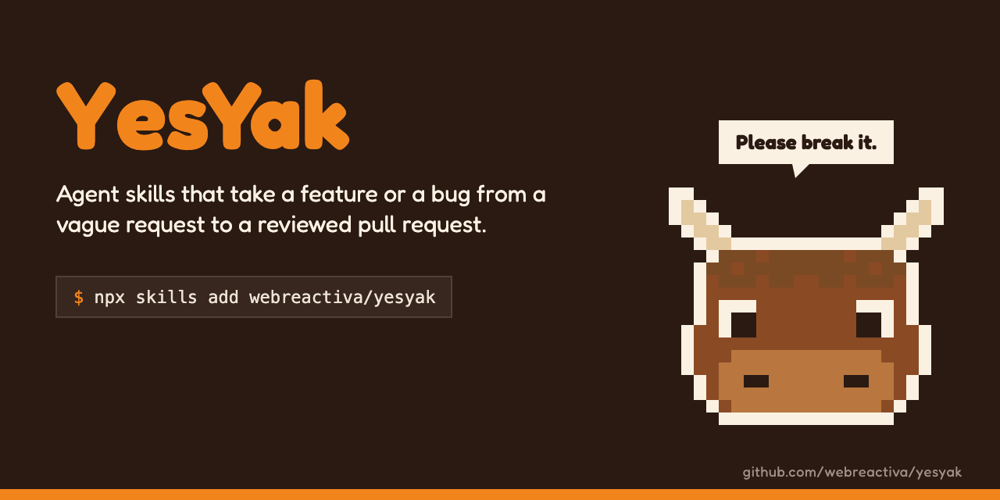

<p align="center"></p>

# YesYak

[English](README.md) · Español

YesYak es un conjunto de skills para agentes que lleva una feature desde una petición vaga, o un bug desde un aviso, hasta una pull request revisada. Pides el resultado con tus palabras. YesYak elige las skills, te enseña un plan corto y trabaja solo: escribe el contrato antes que el código, construye en pasos pequeños, intenta romper su propio trabajo y acaba con una retrospectiva que convierte tus correcciones en guardas. Solo se para donde tiene que decidir una persona, y dice por qué.

No hace falta aprender las skills. Tras la configuración, una sola skill dirige cada ejecución: `yak-pilot`.

https://github.com/user-attachments/assets/ff93a755-f03a-414a-b94b-6545d0f5622f

**Probado con agentes.** Cada skill ha corrido en al menos una de las ejecuciones del [benchmark](#benchmark), sobre proyectos reales, con Claude Code y OpenCode y seis modelos. Cada fallo del agente acabó en un cambio de skill y una versión nueva.

**Rómpelo, por favor.** YesYak mejora cada vez que falla. Úsalo en tu proyecto, con tu agente y tu modelo, y cuéntanos dónde se equivoca (ver [Rómpelo](#rómpelo)).

## Empieza

<p align="center"></p>

1. En la raíz del proyecto: `npx skills add webreactiva/yesyak`. Elige todas las skills.
2. Abre una sesión nueva del agente y di "set up YesYak". Responde sus preguntas una vez.
3. Dale la tarea al piloto: `/yak-pilot Que los clientes puedan cancelar un pedido antes del envío`. En un agente sin comandos con barra, nómbralo: "yak-pilot: …". Te enseña un plan corto; apruébalo y responde solo donde se pare.
4. Si te pierdes, pregunta "what now?" ("¿y ahora qué?").

## Instalación

```bash
npx skills add webreactiva/yesyak                                       # pregunta qué skills y qué agentes
npx skills add webreactiva/yesyak --skill '*' --agent claude-code -y    # todo, para un agente, sin preguntas
```

Usa el ámbito del proyecto (el de por defecto dentro de un proyecto), para que todo el equipo tenga el mismo proceso. `npx skills update` las actualiza. Después de actualizar, ejecuta `python3 <carpeta de skills>/ask-yak/scripts/check_yesyak.py`: avisa de los ajustes que la versión nueva rompe.

Las skills no hacen nada hasta que el proyecto tiene el bloque YesYak en AGENTS.md. Lo escribe el paso 2.

Otras dos formas:

- **`install.sh`**: clona este repositorio y ejecuta `./install.sh -t /ruta/al/proyecto`. Enlaza cada skill y escribe un bloque YesYak mínimo. `./install.sh -h` lista las opciones.
- **Enlazar una carpeta**: guarda una copia de YesYak en tu máquina y enlaza su carpeta `skills/` en el proyecto. No se copia nada, `git pull` en tu copia actualiza todos los proyectos y dos `rm` lo quitan:

  ```bash
  git clone https://github.com/webreactiva/yesyak ~/yesyak
  cd /ruta/al/proyecto && mkdir -p .claude .agents
  ln -s ~/yesyak/skills .claude/skills      # Claude Code y OpenCode
  ln -s ~/yesyak/skills .agents/skills      # Codex y OpenCode
  printf '.claude/skills\n.agents/skills\n' >> .git/info/exclude
  ```

  Sirve solo si el proyecto no tiene ya su propia carpeta de skills; si la tiene, usa `install.sh`. Para quitarlo: `rm .claude/skills .agents/skills`.

## Cómo es una ejecución

Tras aprobar el plan, el agente recorre las fases solo y te enseña una línea de estado por fase. Puedes interrumpirlo cuando quieras. Con el preset `collaborator`, además se para al final de cada fase:

<p align="center"></p>

- **Si paras**, di "we stop here" ("lo dejamos aquí"). `handoff-and-resume` escribe una nota en `docs/handoffs/`, y en la sesión siguiente "let's continue" retoma en el paso correcto.
- **Si el proceso no encaja con tu equipo**, pídele a `customize-yak` el cambio ("aquí nunca probamos en un navegador"). Lo escribe en `.agents/yesyak.json`; ninguna skill se edita.

## Cuándo te pregunta

`yak-pilot` revisa cada decisión con tres reglas, en este orden:

1. **Tu perfil.** Una entrada "always ask" lo para; una "never" es un límite que no cruza.
2. **Los criterios de gate.** Se para si la decisión cambia un contrato o un comportamiento que ya existe, la seguridad o los datos privados, el esquema de datos o el alcance; si debilita una comprobación; si ninguna fuente lo decide y las opciones dan resultados distintos a los usuarios; si cuesta dinero o tiempo de más; o si no sabe clasificarla.
3. **Tu preset.**

| Preset | Tu papel | Se para |
| --- | --- | --- |
| `approver` (por defecto) | Apruebas el plan y las decisiones con riesgo | En el plan y en los criterios de gate |
| `collaborator` | Decides con él en cada fase | En cada fase y en los criterios de gate |
| `observer` | Miras y puedes interrumpir | Solo en las reglas de tu perfil |

El resto lo decide solo y lo deja anotado, con el motivo, en la pull request.

## Casos de uso

| Quieres | Di | Qué pasa |
| --- | --- | --- |
| Una feature desde una idea vaga | "Los clientes deberían poder cancelar un pedido." | Preguntas que bloquean, plan, y el pipeline entero solo: spec, plan, pasos, verificación, red team, PR, retrospectiva |
| Arreglar un bug | "Cancelar un pedido enviado da un 500." | Triaje de solo lectura, un test que falla, el arreglo y una PR corta |
| Varias cosas a la vez | "Añade cancelación, reembolsos y exportar pedidos." | Propone dividirlo en entregas y empieza por la primera |
| Trabajo mientras no estás | "Esta tarde no estoy, hazlo sin mí." | El preset `observer`: cada decisión queda anotada en la PR |
| Un solo paso | "Escribe una spec para esto." | Solo la skill de ese paso |
| Que un error no se repita | "¿Cómo evitamos esto la próxima vez?" | `session-retrospective-rules` propone la guarda más barata: un test, un comando o un hook |

## Rómpelo

Cuando un agente se salte un paso, haga algo mal o tengas que corregirlo, abre una issue con el agente y el modelo, lo que pediste, la fase o skill donde falló, lo que hizo y lo que esperabas. No pegues código ni datos que no puedas compartir.

## Contribuir

Las issues y pull requests son bienvenidas. [AGENTS.md](AGENTS.md) tiene las reglas para cualquier cambio. Las skills se escriben en inglés: el agente entiende peticiones en cualquier idioma.

## Benchmark

YesYak se prueba en proyectos reales: una skill interna lleva a un agente por el proceso mientras Claude Code hace de usuario. Los resultados por ejecución y por modelo están en [bench/RESULTS.md](bench/RESULTS.md), y cada ejecución en [bench/LOG.md](bench/LOG.md).

## Licencia

[MIT](LICENSE)
