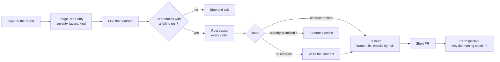
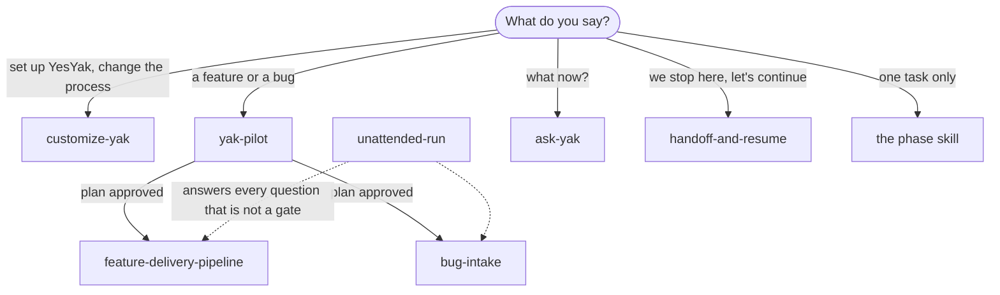
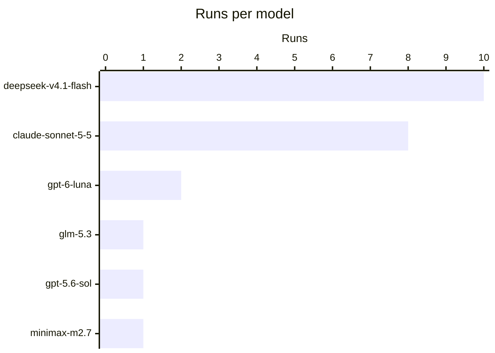
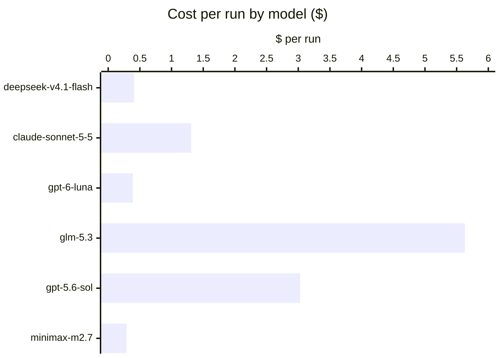
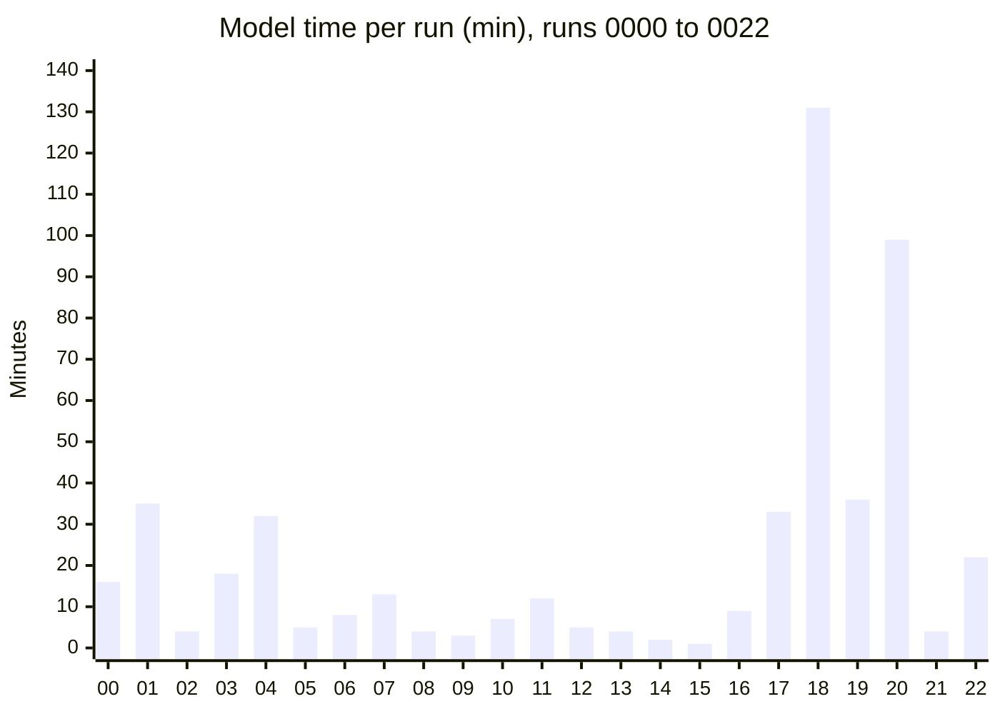

<p align="center"></p>

# YesYak

YesYak is a set of agent skills that takes a feature from a vague request, or a bug from a report, to a reviewed pull request. You ask for the result in your own words. YesYak chooses the skills, shows you a short plan, and then works alone: it writes the contract before the code, builds in small integrated steps, tries to break its own work, and ends with a retrospective that turns your corrections into guards. It stops for you only where a human must decide, and it says why.

You do not need to learn the skills. After the setup, one skill drives every run: `yak-pilot`. The other skills are its parts. You can still call one alone, but YesYak only makes sense as a whole when the pilot leads.


https://github.com/user-attachments/assets/ff93a755-f03a-414a-b94b-6545d0f5622f


**100% tested with AI agents.** Every skill ran in at least one of 23 benchmark runs on real projects, with Claude Code and OpenCode and six models. In each run one agent did the work and another agent played the human user. Every place where the agent failed became a skill change and a release (see [the benchmark](#benchmark)).

**Please break it.** YesYak gets better each time it fails. Use it on your project, with your agent and your model, and find where it goes wrong (see [Break it](#break-it)).

The skills follow the open SKILL.md format. Each skill works on its own, except `customize-yak`, which needs `ask-yak` (its skill cards and its check script).

## Quick start

1. In the root of your project: `npx skills add webreactiva/yesyak`. Take all the skills.
2. Start a new agent session and say "set up YesYak". Answer its questions once.
3. Give the pilot the task: `/yak-pilot Let customers cancel an order before it ships` or `/yak-pilot Cancelling a shipped order returns a 500`. In an agent without slash commands, name it: "yak-pilot: …". It shows a short plan; approve it, then answer only where it stops for you. A plain request without the name usually starts it too (the YesYak block says so), but the name is the sure way.
4. When you are lost, ask "what now?".

The [use cases](#use-cases) show what to say for each kind of work. The [user journey](#user-journey) explains each step.

## Install

In the root of your project:

```bash
npx skills add webreactiva/yesyak
```

The command asks which skills and which agents. Take all the skills. To install everything for one agent without questions:

```bash
npx skills add webreactiva/yesyak --skill '*' --agent claude-code -y
```

Use the project scope (the default inside a project), so the skills go to the project's skills folder (for example `.claude/skills/`) and the team gets the same process. `npx skills update` updates them later. After an update, run `python3 <skills folder>/ask-yak/scripts/check_yesyak.py`. It reports adjustments that the new version breaks, for example a section that was renamed.

The skills do nothing until the project has the YesYak block in AGENTS.md. Step 2 of the user journey writes it. Without the block, agents often skip the skills for a small change.

Alternative: clone this repository and run `./install.sh -t /path/to/project`. It links the skills and also writes a minimal YesYak block, `@AGENTS.md` in CLAUDE.md and `.scratchpad/` in `.gitignore`. Then the agent offers step 2 by itself. `./install.sh -h` lists the options.

## User journey

1. **Install the skills** with `npx skills add webreactiva/yesyak` (see [Install](#install)).
2. **Set up YesYak.** Start a new session in the project and say "set up YesYak". `customize-yak` detects the check commands (tests, lint, types), the commit convention, the docs folder and the agent's instructions file. It asks only what it cannot detect, shows a preview, and after your yes it writes the YesYak block in AGENTS.md (and `@AGENTS.md` in CLAUDE.md for Claude Code) in its own commit. You do this once per project.
3. **Give the task to the pilot**: `/yak-pilot <the task in your own words>`, or "yak-pilot: …" in an agent without slash commands.
   - A feature: "Let customers cancel an order before it ships."
   - A bug: "Cancelling a shipped order returns a 500."

   You do not choose skills. `yak-pilot` reads the request, the code and your profile. If something blocks the work, it asks one round of questions, each with a recommended option. Then it shows a plan of five lines: the route, whether a spec and a plan are needed, the data changes, where it will stop for you, and the end point.
4. **Approve the plan once.** From there the agent runs alone: spec, build, verification, red team, fixes, pull request text and retrospective. You see one status line per phase and can interrupt at any time.
5. **Answer at each gate.** A gate is a decision that a human must take (see [When it asks you](#when-it-asks-you)). It comes with a short summary, the evidence and the options, the recommended one first. With the `collaborator` preset you also get a checkpoint after every phase:

   | Phase | What you get | Your part |
   | --- | --- | --- |
   | 0 Starter kit | A branch, a progress file, "does it fit in one iteration?" | Confirm the branch, or choose what goes first |
   | 1 Grill & sketch | Rounds of multiple-choice questions | Pick options |
   | 2 Write the contract | `docs/<slug>-spec.md` with acceptance criteria, then a step plan | Approve or change |
   | 3 Make it work | One commit per step, each with tests and a manual check | Approve the build |
   | 4 Break it | A verification against the spec, an optional red team | Choose the fixes |
   | 5 Sign your work | A pull request with a plain-language summary and diagrams | Review it |
   | 6 Retrospective | What you corrected, and a guard for each (test, hook, rule) | Approve the guards |
   | 7 Later (optional) | A production readiness review, when you prepare a deploy | Ask for it, then choose the fixes |

6. **When you are lost**, ask "what now?". `ask-yak` shows where the work is and the next step.
7. **When you stop**, say "we stop here". `handoff-and-resume` writes a dated note in `docs/handoffs/`. In the next session, say "let's continue" and the agent checks the note against the repository before it goes on.
8. **When the process does not fit your team**, ask `customize-yak` to change it ("we never test in a browser", "use my spec template"). It writes the change to `.agents/yesyak.json`; no skill is edited.


## When it asks you

`yak-pilot` checks every decision against three rules, in this order. The first rule that matches decides.

1. **Your profile.** An "always ask" entry stops the run; a "never" entry is a limit the agent does not cross.
2. **The gate criteria.** The agent stops when a decision changes a contract or behavior that already exists, security or private data, the data schema, or the scope; when it would weaken a check (a test, a timeout, "the failure was already there"); when no source decides it and the options give users different results; when it costs money or time over what you set; or when the agent cannot classify it.
3. **Your preset.**

| Preset | Your role | It stops for you |
| --- | --- | --- |
| `approver` (default) | You approve the plan and the risky decisions | At the plan, and at the gate criteria |
| `collaborator` | You decide with it at each phase | At every phase checkpoint, and at the gate criteria |
| `observer` | You watch and can interrupt | Only at your profile's rules |

Every other decision the agent takes alone, and logs with its reason in the pull request. Your profile lives in `.agents/yesyak.json` (`customize-yak` asks for it on the first setup). Say a rule in the chat, for example "always ask me before you change output that users already get", and it goes to the file. At the end of each run the retrospective counts your answers per kind of gate and proposes profile changes, for example to drop a gate you always approve. A change that gives the agent more freedom needs your explicit yes.

## Use cases

| You want | Say | What happens |
| --- | --- | --- |
| A new feature from a vague idea | "Customers should be able to cancel an order." | `yak-pilot` asks what blocks the work, shows a plan, then runs the full pipeline alone: spec, plan, steps, verification, red team, PR, retrospective |
| A bug fixed | "Cancelling a shipped order returns a 500." | Read-only triage first (severity, layers with file and line, root cause), a failing test, the fix, a short PR |
| More than one thing at once | "Add cancellation, refunds and an order export." | Phase 0 says "split", proposes deliveries and their order, and starts with the first |
| Work done while you are away | "I am away this afternoon, do it without me." | The `observer` preset: no stop except your profile's rules; `unattended-run` answers each question with the recommended option and logs every decision with its reason in the PR |
| Work done alone, with a stop only where it matters | Any request; "always ask me before a merge" sets the profile | `yak-pilot` asks only the questions that block the run, plans the skills and the human-in-the-loop gates with a reason for each, and after one approval runs alone up to the PR |
| A pause and a resume | "We stop here." Next day: "Let's continue." | A handoff note with the decisions and who took them; the next session resumes at the right step |
| A teammate takes over | "Prepare this for a colleague." | The same handoff note, plus a reviewer guide for the pull request (`pr-reviewer-guide`) |
| Only one step | "Write a spec for this." "Review this branch like an attacker." "Write the PR description." | The skill for that step alone (`write-acceptance-spec`, `red-team-review`, `write-visual-pr`) |
| A mistake that must not happen again | "How do we avoid this next time?" | `session-retrospective-rules` proposes the cheapest guard that a machine can check: a test, a command or an agent hook (`agent-hook-guard`) |
| A different process for your team | "Skip work items here." "Verify with Playwright too." | `customize-yak` writes an adjustment that every agent applies; `python3 <skills folder>/ask-yak/scripts/check_yesyak.py` validates it |

The bug route of `bug-intake`:



A user skill with the same name as a project skill can shadow it. If the skill tool prints a base directory that is neither in the project's skills folder nor the target of a symlink there, read the project `SKILL.md` directly (`feature-delivery-pipeline` checks this). If it happens often, rename your own skill, not the YesYak one, because settings files use the YesYak names.

## Under the hood

You only need the [quick start](#quick-start). This part is for people who change YesYak or call one skill alone.

### Entry points



| Start from | Skill |
| --- | --- |
| "What now?", "where am I?", "which skill?" | `ask-yak` |
| Change the process, or a first install | `customize-yak` |
| A feature request or a bug report | `yak-pilot`, which plans the skills and the stops, then runs `feature-delivery-pipeline` or `bug-intake` |
| A run without questions | the `observer` preset; `unattended-run` answers the questions |
| A pause, or work that passes to someone else | `handoff-and-resume` (writes `docs/handoffs/`, and resumes from it) |
| One task only | the phase skill for it, for example `write-visual-pr` or `red-team-review` |

### Owner skills

Each topic has one owner skill. It keeps the full rule, even when the project's AGENTS.md repeats it, because other projects may not have that AGENTS.md. When the project's AGENTS.md says something different, the project wins. Other skills name the owner instead of copying its rules.

| Topic | Owner |
| --- | --- |
| Branches, slugs, commits | `git-commit-organizer` |
| Working files, reports, manual test helpers | `scratchpad-working-files` |
| Language and writing style | `simplified-technical-language` |
| Findings and severities | `traffic-light-findings` |
| Decision records | `decision-record-log` |
| Plain-language openings and diagrams | `plain-visual-docs` |
| The process map, skill cards and state signals | `ask-yak` (`references/process.md`); the pipeline's phase block lists the same skills |
| Slop in code, tests and docs | `no-slop-code` |
| The plan of skills, gates and presets | `yak-pilot`; `customize-yak` writes the profile |

## What the skills expect from the project

| Need | Used by | Without it |
| --- | --- | --- |
| A full check: tests, plus lint and types if the project has them (for example `npm test` and `npm run lint`) | `execute-plan-loop`, `bug-intake`, `git-commit-organizer` | Say which checks you ran by hand |
| `docs/` for specs, plans and `docs/decisions/` for ADRs | `write-acceptance-spec`, `walking-skeleton-plan`, `decision-record-log` | The skills create them |
| A published contract (OpenAPI, CLI help, docs) | `bug-intake` | The skill writes an assumed contract and asks |
| Subagents | `red-team-review` (required); `feature-walkthrough`, `plain-visual-docs`, `prototype-options`, `write-acceptance-spec` (optional) | `red-team-review` tells the user and stops; the others do the work in the main session |
| A question tool | `on-the-spot` | Ask in the chat |
| `gh`, `glab` or `az` | `write-visual-pr`, `pr-reviewer-guide`, `work-items-breakdown` | Use the environment's tools, or write a markdown list |
| Hooks in the agent tool (for example Claude Code hooks or OpenCode plugins) | `agent-hook-guard` | Propose a test or a command instead |
| Chrome DevTools MCP, or Playwright and a browser | `browser-acceptance-testing` | Only on the user's request; ask before you switch tools |
| Node.js with `npx`, and a browser for Mermaid | `plain-visual-docs` | The skill says how to point the renderer to an installed browser |
| Python 3 | `feature-walkthrough` (citation check), `plain-visual-docs` (block extraction), `customize-yak` (`check_yesyak.py`) | Check citations, blocks and settings files by hand |

## Change the process

Do not copy a skill to change it. Put the change in a settings file, and every agent applies it through the YesYak block of AGENTS.md:

| File | Scope |
| --- | --- |
| `.agents/yesyak.json` | The project, in git, for the whole team |
| `~/.agents/yesyak.json` | Only you, in every project whose instructions run the check: a project with the YesYak block, or every project when your personal instructions file has the same line (`customize-yak` proposes it) |

Each entry names a skill and a mode: `add` (extra instructions), `replace` (one section that the skill card lists), or `off` (skip an optional step). At the start of a session the agent runs `check_yesyak.py` and applies only the `active:` lines it prints; if the check fails, no adjustment applies. The project wins when both files change the same skill. Settings files are instructions for the agent. Review a change to them like a change to code. `customize-yak` asks what you want, shows a diff and writes the files; run it again to audit the block. The skill cards in `ask-yak/references/process.md` list what each skill allows.

## Break it

The goal of opening YesYak is to find where it fails. The benchmark tests a few projects and models; your project and your agent test more. When an agent skips a step, takes a wrong action, or you must correct it, open an issue with:

- the agent and the model;
- what you asked, and the phase or skill where it went wrong;
- what the agent did, and what you expected;
- your correction, if you made one.

The output of `ask-yak` or the retrospective of `session-retrospective-rules` is a good start for the issue. Do not paste code or data that you cannot share. Each confirmed failure becomes a skill change, like the findings in [`bench/LOG.md`](bench/LOG.md).

## Contributing

Issues and pull requests are welcome. [AGENTS.md](AGENTS.md) has the rules for every change, for people and agents: keep each skill usable on its own, remove one rule for each new rule, and do not rename skills or the sections that a card lists as Replaceable, because settings files in other projects use those names. Run `python3 skills/ask-yak/scripts/check_yesyak.py --dev` after each skill change; it must exit 0.

## Benchmark

YesYak is tested on small real projects from GitHub. An internal skill of this repository (`.claude/skills/yak-bench/`, not installed by `npx skills`) drives an agent as a puppet through the process, in tmux, while Claude Code plays the human user: it answers the checkpoints, and it corrects the agent only where a real user would. Each run is scored, every correction becomes a finding, and confirmed findings become skill changes and a release. The full record is in [`bench/LOG.md`](bench/LOG.md) (runs, findings, metrics), [`bench/runs/`](bench/runs/) (one report per run) and [`bench/FLOWS.md`](bench/FLOWS.md) (the skills each run used).

All figures are from 2026-10-17 and 2026-10-18, versions v0.1.0 to v0.4.3.

### In numbers

| | |
| --- | --- |
| Runs | 23 (0000 to 0022) |
| Agents | OpenCode (15 runs), Claude Code (8 runs) |
| Models | 6: deepseek-v4.1-flash, claude-sonnet-5-5, gpt-6-luna, gpt-5.6-sol, glm-5.3, minimax-m2.7 |
| Languages | Python, Go, TypeScript and JavaScript, PHP, Rust |
| Routes | 16 features, 5 bugs, 2 runs as a user who does not know YesYak |
| Findings | 70: skill, model, agent and benchmark defects |
| Releases | 16 tags, v0.1.0 to v0.4.3 |
| Puppet time | 503 minutes of model work, 3,331 model steps, 282 human turns |
| Puppet cost | 24.26 $ for all runs |
| Driver cost | 54.58 $ for Claude Code (Opus) as the human, in the time of the runs |

Costs are the equivalent at the prices of the [models.dev API](https://models.dev/api.json). The Claude Code runs used a subscription. The driver cost does not include the time spent writing the skills.

### By model





<details>
<summary>The full table by model</summary>

| Model | Agent | Runs | Turns | Model steps | Model time | Output tokens | Cache read | Cost $ | $ per run |
| --- | --- | --- | --- | --- | --- | --- | --- | --- | --- |
| deepseek-v4.1-flash | OpenCode | 10 | 133 | 1,977 | 324 min | 1,661k | 287.6M | 4.05 | 0.41 |
| claude-sonnet-5-5 | Claude Code | 8 | 74 | 538 | 84 min | 346k | 39.3M | 10.48 | 1.31 |
| gpt-6-luna | OpenCode | 2 | 45 | 517 | 39 min | 224k | 56.5M | 0.78 | 0.39 |
| glm-5.3 | OpenCode | 1 | 15 | 140 | 32 min | 158k | 17.6M | 5.63 | 5.63 |
| gpt-5.6-sol | OpenCode | 1 | 2 | 56 | 16 min | 35k | 4.5M | 3.03 | 3.03 |
| minimax-m2.7 | OpenCode | 1 | 13 | 103 | 8 min | 28k | 3.7M | 0.29 | 0.29 |
| **All** | | **23** | **282** | **3,331** | **503 min** | **2,453k** | **409.3M** | **24.26** | **1.05** |

</details>

Run 0018 also used minimax-m2.7 for part of one session; its figures count under deepseek-v4.1-flash.

What the models did with the same process:

- **deepseek-v4.1-flash** was the best value: complete runs for 0.05 to 0.32 $, with real findings from its red team, and the first unattended run. On a large app (0018) it wrote a handoff without being asked, resumed from it in a new session, and finished a delivery alone.
- **claude-sonnet-5-5** gave the best code and retrospectives, but it skips steps that it thinks a change does not need. Without the YesYak block it skipped the whole process (runs 0009, 0014, 0015). With the block, it ran every phase (0010, 0016). On a large app (0019) it built a 10-step delivery alone after a handoff, and replaced the review phases with its own code review.
- **gpt-6-luna** needed the most corrections and loaded skills it did not need.
- **glm-5.3** ran every phase with no intervention and built the first agent hook, at the highest cost per run.
- **minimax-m2.7** needed four corrections and one nudge, in setup, in the spec and at the pull request. In 0018 it resumed a cut session without any skill and called a new test failure pre-existing.

### By run



Runs 0018 to 0020 and 0022 were on a large web app, with several sessions each.

<details>
<summary>The full table by run</summary>

| Run | Agent · model | Project · task | Result | Nudges / corrections / rescues | Model time | Cost $ |
| --- | --- | --- | --- | --- | --- | --- |
| 0000 | OpenCode · gpt-5.6-sol | local CLI · feature | pilot, stopped at the spec | unattended | 16 min | 3.03 |
| 0001 | OpenCode · gpt-6-luna | py-candlestick-chart · feature | all phases | 3 / 5 / 1 | 35 min | 0.73 |
| 0002 | OpenCode · gpt-6-luna | sjson (Go) · bug | fix route | 2 / 0 / 1 | 4 min | 0.05 |
| 0003 | OpenCode · deepseek-v4.1-flash | html-to-markdown (PHP) · feature | all phases | 0 / 3 / 0 | 18 min | 0.21 |
| 0004 | OpenCode · glm-5.3 | p-memoize (TypeScript) · feature | all phases + agent hook | 0 / 0 / 0 | 32 min | 5.63 |
| 0005 | OpenCode · deepseek-v4.1-flash | vivid (Rust) · bug | fix route | 0 / 0 / 0 | 5 min | 0.05 |
| 0006 | OpenCode · minimax-m2.7 | serialize-error (JavaScript) · feature | all phases | 1 / 4 / 0 | 8 min | 0.29 |
| 0007 | OpenCode · deepseek-v4.1-flash | filenamify (JavaScript) · feature | all phases | 0 / 1 / 0 | 13 min | 0.12 |
| 0008 | OpenCode · deepseek-v4.1-flash | retry-go (Go) · feature, user who does not know YesYak | feature built, no process | 6 forced mistakes | 4 min | 0.05 |
| 0009 | Claude Code · claude-sonnet-5-5 | filenamify · feature, as 0007 | process skipped | 0 / 0 / 0 | 3 min | 0.32 |
| 0010 | Claude Code · claude-sonnet-5-5 | filenamify · feature, as 0007 | all phases | 0 / 0 / 0 | 7 min | 1.86 |
| 0011 | OpenCode · deepseek-v4.1-flash | retry-go · three requests, session cut | split, handoff, resume, all phases | 0 / 0 / 0 | 12 min | 0.15 |
| 0012 | OpenCode · deepseek-v4.1-flash | python-tabulate · bug, unattended | fix route, no user | 0 / 0 / 0 | 5 min | 0.08 |
| 0013 | Claude Code · claude-sonnet-5-5 | humanize (Python) · bug with a design choice | fix route | 0 / 0 / 0 | 4 min | 0.63 |
| 0014 | Claude Code · claude-sonnet-5-5 | inflect (Python) · feature, user who does not know YesYak | feature built, no process | 6 forced mistakes | 2 min | 0.29 |
| 0015 | Claude Code · claude-sonnet-5-5 | gomodifytags (Go) · feature, no setup | code on main, no process | 0 / 0 / 0 | 1 min | 0.12 |
| 0016 | Claude Code · claude-sonnet-5-5 | gomodifytags · as 0015, new install | all phases | 0 / 1 / 0 | 9 min | 1.07 |
| 0017 | OpenCode · deepseek-v4.1-flash | MCU-Countdown (Python, Docker) · feature, work items, walkthrough, production readiness | all phases + production review | 0 / 0 / 0 | 33 min | 0.32 |
| 0018 | OpenCode · deepseek-v4.1-flash, minimax-m2.7 | a large web app · 2 of 5 deliveries, 4 sessions, 3 forced cuts, one unattended | 2 deliveries, all phases | 0 / 2 / 1 | 131 min | 2.58 |
| 0019 | Claude Code · claude-sonnet-5-5 | the same app · delivery 3, one cut, then unattended | built and merged, review phases replaced by a code review | 0 / 0 / 0 | 36 min | 3.85 |
| 0020 | OpenCode · deepseek-v4.1-flash | the same app · delivery 4, one cut, then unattended | all phases, merge left to the user | 0 / 0 / 0 | 99 min | 0.45 |
| 0021 | OpenCode · deepseek-v4.1-flash | linkify-urls (JavaScript) · bug | fix route | 0 / 0 / 0 | 4 min | 0.04 |
| 0022 | Claude Code · claude-sonnet-5-5 | the same app · delivery 5, YesYak already set up | built in one turn after "go ahead", retrospective over both sessions | 0 / 0 / 0 | 22 min | 2.34 |

</details>

A nudge means the user told the agent something that a skill should have told it; a correction stopped a wrong action; a rescue unblocked a stuck agent.

### What the benchmark changed

- **Setup decides everything.** Without the YesYak block, no model started the process for a plain request. With it, a strong model ran every phase. That is why `install.sh` writes a minimal block and the user journey starts with "set up YesYak".
- **Checks must be real.** Setup now detects the full check (tests, lint, types), runs it once, records the failures that are already there, and names each step as it ran. A pipe in front of a check once let a failing commit through.
- **Specs stay short.** Four runs wrote specs several times longer than the code. The spec skill now keeps only what a reviewer needs.
- **Retrospectives turn corrections into guards.** They start from every user message, and prefer a test, a command or an agent hook to a written rule.
- **Work survives a cut.** A handoff in git and `progress.md` carried one piece of work across four sessions and two models. The retrospective now covers the whole piece of work, and an unattended run never ends a turn to wait.
- **Three runs in a row with no new skill finding** (0019 to 0021, one of them with Sonnet), and a fourth (0022). This was the goal of the series.
- **Every skill has been used in at least one run.** Run 0017 was the first to use `work-items-breakdown`, `feature-walkthrough` and `production-readiness-review` in this series.

## License

[MIT](LICENSE)
