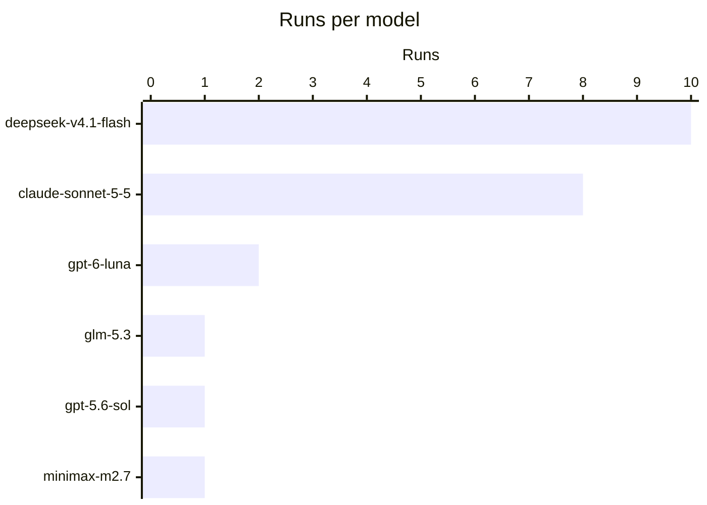
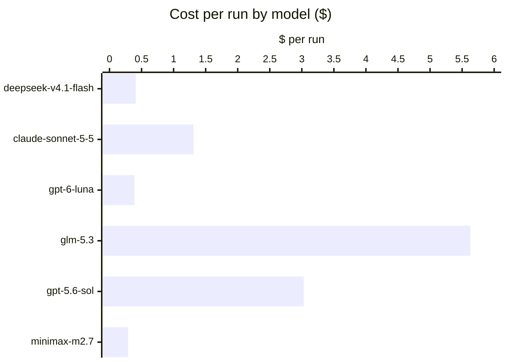
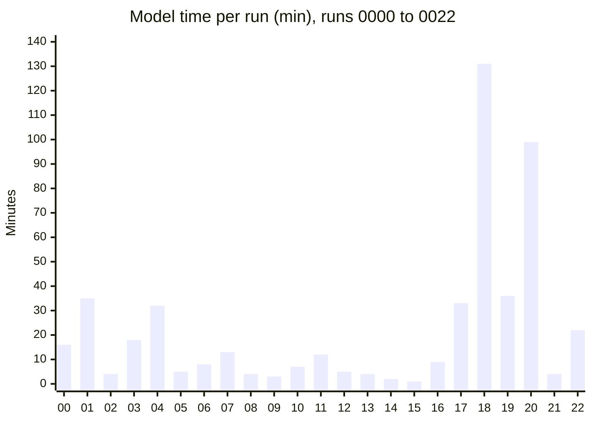

# Benchmark results

YesYak is tested on real projects. An internal skill of this repository (`.claude/skills/yak-bench/`, not installed by `npx skills`) drives an agent as a puppet through the process while Claude Code plays the human user. Every run is in [LOG.md](LOG.md), with one file per run in [runs/](runs/) and the skills each run loaded in [FLOWS.md](FLOWS.md).

## Autopilot series: runs 0023 to 0038

These runs test `yak-pilot` (issue #1): the user asks for the result, approves one plan, and answers only where the agent stops. The human never names a skill. Every stop where the run waited for the human is listed in the run file, in an "HIL stops" table.

| Run | Agent · model | Project · task | Preset | Plan gates | Profile stops | Missed gates | Gates too many | Extra messages after the plan | Planned skills skipped |
| --- | --- | --- | --- | --- | --- | --- | --- | --- | --- |
| [0023](runs/0023-humanize-bytes-autopilot.md) | OpenCode · deepseek-v4.1-flash | humanize · clear bug | none (first version) | 1 | 0 | 0 | 0 | 0 | 0 |
| [0024](runs/0024-tabulate-colsep-autopilot.md) | OpenCode · deepseek-v4.1-flash | tabulate · ambiguous API feature | none (first version) | 2 | 0 | 2 | 0 | 1 correction | 5 |
| [0025](runs/0025-tabulate-rowalign-pilot.md) | OpenCode · deepseek-v4.1-flash | tabulate · clear bug | observer | 0 | 0 | 0 | 0 | 0 | 0 |
| [0026](runs/0026-tabulate-floatfmt-pilot.md) | OpenCode · deepseek-v4.1-flash | tabulate · ambiguous feature | approver | 2 | 1 | 0 | 0 | 2 (a stall, fixed) | 0 |
| [0027](runs/0027-humanize-locale-pilot.md) | OpenCode · deepseek-v4.1-flash | humanize · risky change on a hot path | approver | 2 | 1 | 0 | 0 | 0 | 0 |
| [0028](runs/0028-tabulate-stralign-pilot2.md) | OpenCode · deepseek-v4.1-flash | tabulate · second session after a profile rule | approver + rule | 0 | 2 | 0 | 0 | 0 | 0 |
| [0029](runs/0029-sopravolare-notes.md) | OpenCode · glm-5.3, then deepseek-v4.1-flash | the user's Laravel app · subscriber feature | approver | 1 | 1 | 0 | 0 | 2 provider resumes | 0 |
| [0030](runs/0030-webfront-structured-data.md) | OpenCode · minimax-m2.7 | the user's Next.js app · ambiguous feature | default | 3 | 0 | 0 | 1 | 1 provider resume | 4 required steps left out of the plan |
| [0031](runs/0031-sopravolare-goals-claude.md) | Claude Code · claude-sonnet-5-5 | the user's Laravel app · subscriber feature | approver | 1 | 1 | 2 | 0 | 0 | 1 |
| [0032](runs/0032-webfront-cookies-claude.md) | Claude Code · claude-sonnet-5-5 | the user's Next.js app · cookie consent | default | 2 | 1 | 0 | 0 | 0 | 1 |
| [0033](runs/0033-sopravolare-reminders-claude.md) | Claude Code · claude-sonnet-5-5 | the user's Laravel app · subscriber email | approver | 1 (with the schema gate) | 1 | 1 | 0 | 0 | 0 |
| [0034](runs/0034-webfront-structured-data-claude.md) | Claude Code · claude-sonnet-5-5 | the user's Next.js app · same task as 0030 | approver | 1 | 1 | 0 | 0 | 0 | 0 |
| [0035](runs/0035-icecream-timing-pilot.md) | OpenCode · minimax-m2.7 | icecream · ambiguous feature | approver | 1 | 1 | 1 | 1 | 0 | review steps left out of the plan |
| [0036](runs/0036-gohumanize-year-pilot.md) | OpenCode · deepseek-v4.1-flash | go-humanize · clear bug, existing output | approver | 2 | 1 | 0 | 0 | 0 | 1 |
| [0037](runs/0037-icecream-timing-pilot2.md) | OpenCode · minimax-m2.7 | icecream · same task as 0035 | approver | 1 | 0 | 1 | 0 | 0 | review steps left out of the plan |
| [0038](runs/0038-icecream-timing-glm.md) | OpenCode · glm-5.3-flash | icecream · same task as 0035, v0.5.1 | approver | 2 | 1 | 0 | 0 | 0 | 0 |

Plan gates count the plan approval. Profile stops come from "always ask" entries, for example "apply a retrospective guard". A missed gate is a decision the agent took alone that the reviewer would revert or that a gate criterion covers.

What the series showed:

- **The user names no skill.** In sixteen runs the human named none; the pilot chose the route and the skills.
- **Most runs need nothing after the plan.** Twelve of sixteen runs had no extra message after the plan approval; the others were a stall (fixed), a plan correction in the first version, and provider quotas.
- **Gates land on real decisions**: a public API shape, output that users already get, metrics that drop with consent, a new table. Only one gate in the series had no criterion behind it.
- **Strong models skip skills; the plan makes them visible.** Sonnet did the work of a skill by hand in two runs; a Loaded column in the plan now records each load. Weak models copy the shape of an example: deepseek listed every fix-route step (0036), but MiniMax left out the review steps of the feature route twice (0035, 0037), so the example of the plan now lists every step; with it, GLM 5.3 flash planned and ran every step on the same task (0038).
- **The profile learns.** A rule said in the chat went to the settings file and stopped the next change of that kind (0028).
- **Model cost varies a lot.** GLM spent the whole provider budget by the build phase; MiniMax was cheap but left out the review phases; deepseek finished the process for cents; Sonnet gave the best plans and reviews.

## Process series: runs 0000 to 0022

YesYak is tested on small real projects from GitHub. An internal skill of this repository (`.claude/skills/yak-bench/`, not installed by `npx skills`) drives an agent as a puppet through the process, in tmux, while Claude Code plays the human user: it answers the checkpoints, and it corrects the agent only where a real user would. Each run is scored, every correction becomes a finding, and confirmed findings become skill changes and a release. The full record is in [`bench/LOG.md`](bench/LOG.md) (runs, findings, metrics), [`bench/runs/`](bench/runs/) (one report per run) and [`bench/FLOWS.md`](bench/FLOWS.md) (the skills each run used).

All figures are from 2026-10-17 and 2026-10-18, versions v0.1.0 to v0.4.3.

#### In numbers

| | |
| --- | --- |
| Runs | 23 (0000 to 0022) |
| Agents | OpenCode (15 runs), Claude Code (8 runs) |
| Models | 6: deepseek-v4.1-flash, claude-sonnet-5-5, gpt-6-luna, gpt-5.6-sol, glm-5.3, minimax-m2.7 |
| Languages | Python, Go, TypeScript and JavaScript, PHP, Rust |
| Routes | 16 features, 5 bugs, 2 runs as a user who does not know YesYak |
| Findings | 70: skill, model, agent and benchmark defects |
| Releases | 16 tags, v0.1.0 to v0.4.3 |
| Puppet time | 503 minutes of model work, 3,331 model steps, 282 human turns |
| Puppet cost | 24.26 $ for all runs |
| Driver cost | 54.58 $ for Claude Code (Opus) as the human, in the time of the runs |

Costs are the equivalent at the prices of the [models.dev API](https://models.dev/api.json). The Claude Code runs used a subscription. The driver cost does not include the time spent writing the skills.

#### By model

The full table by model

| Model | Agent | Runs | Turns | Model steps | Model time | Output tokens | Cache read | Cost $ | $ per run |
| --- | --- | --- | --- | --- | --- | --- | --- | --- | --- |
| deepseek-v4.1-flash | OpenCode | 10 | 133 | 1,977 | 324 min | 1,661k | 287.6M | 4.05 | 0.41 |
| claude-sonnet-5-5 | Claude Code | 8 | 74 | 538 | 84 min | 346k | 39.3M | 10.48 | 1.31 |
| gpt-6-luna | OpenCode | 2 | 45 | 517 | 39 min | 224k | 56.5M | 0.78 | 0.39 |
| glm-5.3 | OpenCode | 1 | 15 | 140 | 32 min | 158k | 17.6M | 5.63 | 5.63 |
| gpt-5.6-sol | OpenCode | 1 | 2 | 56 | 16 min | 35k | 4.5M | 3.03 | 3.03 |
| minimax-m2.7 | OpenCode | 1 | 13 | 103 | 8 min | 28k | 3.7M | 0.29 | 0.29 |
| **All** | | **23** | **282** | **3,331** | **503 min** | **2,453k** | **409.3M** | **24.26** | **1.05** |

Run 0018 also used minimax-m2.7 for part of one session; its figures count under deepseek-v4.1-flash.

What the models did with the same process:

- **deepseek-v4.1-flash** was the best value: complete runs for 0.05 to 0.32 $, with real findings from its red team, and the first unattended run. On a large app (0018) it wrote a handoff without being asked, resumed from it in a new session, and finished a delivery alone.
- **claude-sonnet-5-5** gave the best code and retrospectives, but it skips steps that it thinks a change does not need. Without the YesYak block it skipped the whole process (runs 0009, 0014, 0015). With the block, it ran every phase (0010, 0016). On a large app (0019) it built a 10-step delivery alone after a handoff, and replaced the review phases with its own code review.
- **gpt-6-luna** needed the most corrections and loaded skills it did not need.
- **glm-5.3** ran every phase with no intervention and built the first agent hook, at the highest cost per run.
- **minimax-m2.7** needed four corrections and one nudge, in setup, in the spec and at the pull request. In 0018 it resumed a cut session without any skill and called a new test failure pre-existing.

#### By run

Runs 0018 to 0020 and 0022 were on a large web app, with several sessions each.

The full table by run

| Run | Agent · model | Project · task | Result | Nudges / corrections / rescues | Model time | Cost $ |
| --- | --- | --- | --- | --- | --- | --- |
| 0000 | OpenCode · gpt-5.6-sol | local CLI · feature | pilot, stopped at the spec | unattended | 16 min | 3.03 |
| 0001 | OpenCode · gpt-6-luna | py-candlestick-chart · feature | all phases | 3 / 5 / 1 | 35 min | 0.73 |
| 0002 | OpenCode · gpt-6-luna | sjson (Go) · bug | fix route | 2 / 0 / 1 | 4 min | 0.05 |
| 0003 | OpenCode · deepseek-v4.1-flash | html-to-markdown (PHP) · feature | all phases | 0 / 3 / 0 | 18 min | 0.21 |
| 0004 | OpenCode · glm-5.3 | p-memoize (TypeScript) · feature | all phases + agent hook | 0 / 0 / 0 | 32 min | 5.63 |
| 0005 | OpenCode · deepseek-v4.1-flash | vivid (Rust) · bug | fix route | 0 / 0 / 0 | 5 min | 0.05 |
| 0006 | OpenCode · minimax-m2.7 | serialize-error (JavaScript) · feature | all phases | 1 / 4 / 0 | 8 min | 0.29 |
| 0007 | OpenCode · deepseek-v4.1-flash | filenamify (JavaScript) · feature | all phases | 0 / 1 / 0 | 13 min | 0.12 |
| 0008 | OpenCode · deepseek-v4.1-flash | retry-go (Go) · feature, user who does not know YesYak | feature built, no process | 6 forced mistakes | 4 min | 0.05 |
| 0009 | Claude Code · claude-sonnet-5-5 | filenamify · feature, as 0007 | process skipped | 0 / 0 / 0 | 3 min | 0.32 |
| 0010 | Claude Code · claude-sonnet-5-5 | filenamify · feature, as 0007 | all phases | 0 / 0 / 0 | 7 min | 1.86 |
| 0011 | OpenCode · deepseek-v4.1-flash | retry-go · three requests, session cut | split, handoff, resume, all phases | 0 / 0 / 0 | 12 min | 0.15 |
| 0012 | OpenCode · deepseek-v4.1-flash | python-tabulate · bug, unattended | fix route, no user | 0 / 0 / 0 | 5 min | 0.08 |
| 0013 | Claude Code · claude-sonnet-5-5 | humanize (Python) · bug with a design choice | fix route | 0 / 0 / 0 | 4 min | 0.63 |
| 0014 | Claude Code · claude-sonnet-5-5 | inflect (Python) · feature, user who does not know YesYak | feature built, no process | 6 forced mistakes | 2 min | 0.29 |
| 0015 | Claude Code · claude-sonnet-5-5 | gomodifytags (Go) · feature, no setup | code on main, no process | 0 / 0 / 0 | 1 min | 0.12 |
| 0016 | Claude Code · claude-sonnet-5-5 | gomodifytags · as 0015, new install | all phases | 0 / 1 / 0 | 9 min | 1.07 |
| 0017 | OpenCode · deepseek-v4.1-flash | MCU-Countdown (Python, Docker) · feature, work items, walkthrough, production readiness | all phases + production review | 0 / 0 / 0 | 33 min | 0.32 |
| 0018 | OpenCode · deepseek-v4.1-flash, minimax-m2.7 | a large web app · 2 of 5 deliveries, 4 sessions, 3 forced cuts, one unattended | 2 deliveries, all phases | 0 / 2 / 1 | 131 min | 2.58 |
| 0019 | Claude Code · claude-sonnet-5-5 | the same app · delivery 3, one cut, then unattended | built and merged, review phases replaced by a code review | 0 / 0 / 0 | 36 min | 3.85 |
| 0020 | OpenCode · deepseek-v4.1-flash | the same app · delivery 4, one cut, then unattended | all phases, merge left to the user | 0 / 0 / 0 | 99 min | 0.45 |
| 0021 | OpenCode · deepseek-v4.1-flash | linkify-urls (JavaScript) · bug | fix route | 0 / 0 / 0 | 4 min | 0.04 |
| 0022 | Claude Code · claude-sonnet-5-5 | the same app · delivery 5, YesYak already set up | built in one turn after "go ahead", retrospective over both sessions | 0 / 0 / 0 | 22 min | 2.34 |

A nudge means the user told the agent something that a skill should have told it; a correction stopped a wrong action; a rescue unblocked a stuck agent.

#### What the benchmark changed

- **Setup decides everything.** Without the YesYak block, no model started the process for a plain request. With it, a strong model ran every phase. That is why `install.sh` writes a minimal block and the user journey starts with "set up YesYak".
- **Checks must be real.** Setup now detects the full check (tests, lint, types), runs it once, records the failures that are already there, and names each step as it ran. A pipe in front of a check once let a failing commit through.
- **Specs stay short.** Four runs wrote specs several times longer than the code. The spec skill now keeps only what a reviewer needs.
- **Retrospectives turn corrections into guards.** They start from every user message, and prefer a test, a command or an agent hook to a written rule.
- **Work survives a cut.** A handoff in git and `progress.md` carried one piece of work across four sessions and two models. The retrospective now covers the whole piece of work, and an unattended run never ends a turn to wait.
- **Three runs in a row with no new skill finding** (0019 to 0021, one of them with Sonnet), and a fourth (0022). This was the goal of the series.
- **Every skill has been used in at least one run.** Run 0017 was the first to use `work-items-breakdown`, `feature-walkthrough` and `production-readiness-review` in this series.
